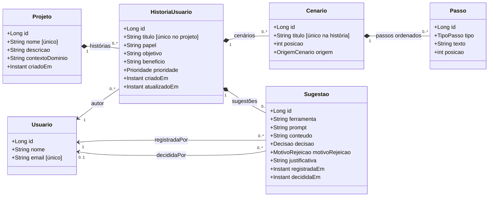

# Diagrama de classes — Estúdio BDD

Diagrama correspondente às seis entidades obrigatórias do enunciado. O bônus com Fluxo/Etapa/Transição não entra até a Semana 3.

## Enums

- `Prioridade`: `ALTA`, `MEDIA`, `BAIXA`.
- `OrigemCenario`: `HUMANO`, `SUGESTAO_IA`.
- `TipoPasso`: `DADO`, `QUANDO`, `ENTAO`, `E`, `MAS`.
- `Decisao`: `PENDENTE`, `ACEITA`, `REJEITADA`.
- `MotivoRejeicao`: `INCORRETA`, `GENERICA`, `DUPLICADA`, `FORA_DO_ESCOPO`, `OUTRO`.

**Estratégia JPA:** `ManyToOne(fetch=LAZY)` evita carregar pais automaticamente; `OneToMany` com `orphanRemoval=true` e `CascadeType.ALL` mantém composição de cenários e passos; serviços são transacionais, de modo que os DTOs são convertidos antes do encerramento da sessão. A ordem é definida pelas posições persistidas, não pela ordem casual de retorno do banco.
